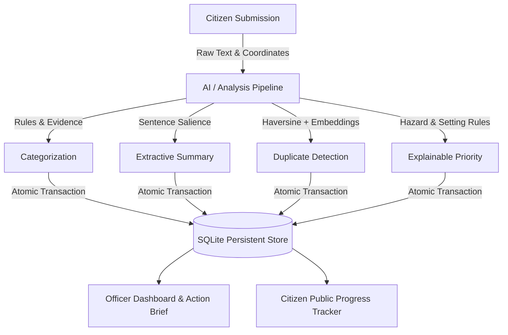

# CityGuard (CivicAction) 🏛️
### Explainable Civic Issue Triage & Operational Intelligence

**CivicAction** is a lightweight, local-first civic technology prototype designed for a solo civic-impact hackathon. It converts scattered, unstructured citizen complaints into prioritized, explainable, and trackable public actions.

---

## 1. Product Journey

1. **Citizen Submits a Complaint**: Description, category, fictional demo area, and coordinates are entered with inline validation.
2. **System Categorizes & Summarizes**: Transparent rule-based keyword matching extracts evidence tokens; extractive summarization selects the salient issue sentence.
3. **Semantic Duplicate Detection**: Using `sentence-transformers` embeddings, complaints within 150m and 7 days with $\ge 0.80$ cosine similarity are surfaced for human review.
4. **Explainable Priority Scoring**: Additive policy (+60 immediate hazard, +20 sensitive setting, +20 access disruption, capped at 100) with conservative negation handling.
5. **Area-Level Grouping & Action Brief**: Computes confirmed unique issue groups versus raw submissions and generates actionable operational briefs.
6. **Officer Review & Assignment**: Internal dashboard validates workflow transitions, allows priority override with mandatory justification, and links duplicates without destructive merging.
7. **Officer Updates Progress**: Department assignment and progress notes are logged in an immutable SQLite audit trail.
8. **Citizen Tracks Progress**: Citizen monitors real-time status and public timeline using their tracking token (internal notes remain strictly private).

---

## 2. Technology Stack & Verified Environment

- **Language**: Python 3.13 (64-bit)
- **UI Framework**: Streamlit (`streamlit>=1.35.0`)
- **Database**: SQLite3 (native Python standard library)
- **Data Analysis**: pandas (`pandas>=2.2.0`)
- **Semantic Embeddings**: Sentence Transformers (`sentence-transformers>=3.0.0`, using `all-MiniLM-L6-v2`)
- **Automated Testing**: pytest (`pytest>=8.2.0`)

> [!NOTE]
> **No External Server / Cloud API Required**: All text processing, embedding computation, and persistence run 100% locally on CPU. No API keys or paid services are used.

---

## 3. Quickstart & Installation (Windows PowerShell)

### Step 1: Clone or Navigate to Project Directory
```powershell
cd c:\Users\TUF\OneDrive\Documents\promptwar
```

### Step 2: Create and Activate Virtual Environment
```powershell
py -3.13 -m venv .venv
.\.venv\Scripts\Activate.ps1
```

### Step 3: Install Verified Dependencies
```powershell
.\.venv\Scripts\pip install -r requirements.txt
```

### Step 4: Seed Synthetic Demonstration Data (40 Reports)
```powershell
.\.venv\Scripts\python seed_data.py
```

### Step 5: Run Automated Tests
```powershell
.\.venv\Scripts\pytest -v
```

### Step 6: Launch the CivicAction Web Application
```powershell
.\.venv\Scripts\streamlit run app.py
```
The app will automatically open in your default browser at `http://localhost:8501`.

---

## 3.1 Optional: Connecting to Supabase Cloud Database

CivicAction works 100% out of the box with local SQLite. If you wish to connect it to a cloud Supabase database:

1. **Copy or edit [.env](file:///c:/Users/TUF/OneDrive/Documents/promptwar/.env)** (or [.env.example](file:///c:/Users/TUF/OneDrive/Documents/promptwar/.env.example)):
   ```env
   DB_BACKEND=supabase
   SUPABASE_URL=https://your-project-id.supabase.co
   SUPABASE_KEY=your-anon-or-service-role-key
   ```
2. **Execute Database Schema**:
   Copy the contents of [supabase_schema.sql](file:///c:/Users/TUF/OneDrive/Documents/promptwar/supabase_schema.sql) and paste them into your **Supabase Dashboard > SQL Editor > Run**.
3. **Sync or Test from UI**:
   In the Streamlit app sidebar under **Demo Controls > ☁️ Supabase Cloud Sync**, click **Test Supabase Connection** and **Sync SQLite Reports to Supabase**.

---

## 4. System Architecture & Data Model



### SQLite Schema (`database.py`)
- **`reports`**: Stores tracking token (`CIVIC-XXXX-XXXX`), original text, citizen and predicted categories, JSON category evidence tokens, extractive summary, coordinates, area, priority score (0–100), JSON priority reasons, override score/label/reason, needs-review flag, analysis status, workflow status, and assigned department.
- **`status_events`**: Immutable audit log of all events (`created`, `assigned`, `status_change`, `priority_override`, `duplicate_linked`, `note_added`) with `is_public` visibility flag and ISO UTC timestamp.
- **`duplicate_relationships`**: Symmetrical and directional candidate links with similarity score, Haversine distance, and review state (`suggested`, `confirmed`, `rejected`). Enforces `source_id != candidate_id`.

---

## 5. Analysis Pipeline Specifications (`ai_pipeline.py`)

1. **Rule-Based Categorization**: Transparent keyword dictionary matching against normalized tokens. Conflicts or absence of matches yield `Other` with `needs_review = True`.
2. **Extractive Summary**: Sentence splitting and scoring based on domain problem keywords; chooses the most salient factual sentence.
3. **Geographic Proximity**: Pure Python Haversine formula calculates distance in metres:
   $$d = 2r \arcsin \left( \sqrt{\sin^2\left(\frac{\Delta\phi}{2}\right) + \cos\phi_1\cos\phi_2\sin^2\left(\frac{\Delta\lambda}{2}\right)} \right)$$
4. **Semantic Similarity**: `all-MiniLM-L6-v2` encodes complaints into normalized vectors; cosine similarity is calculated between candidates within 150m and 7 days.
5. **Explainable Priority**:
   - `Immediate Physical Hazard`: $+60$
   - `Sensitive Community Setting`: $+20$
   - `Critical Access Disruption`: $+20$
   - `Negation Engine`: Conservative regular expressions prevent false hazard triggers (e.g. *"not dangerous"*, *"repaired, no hazard"*).
   - Priority scale: **High (60–100)**, **Medium (30–59)**, **Low (0–29)**.

---

## 6. Troubleshooting

- **Basemap Offline**: If internet is not available for OpenStreetMap tiles, an explicit banner will appear; all table filtering, area grouping, and triage features continue to work without the map.
- **PyTorch / HuggingFace Offline**: If the embedding model cannot be downloaded, the application catches the error, marks semantic detection unavailable with an explicit on-screen warning, and preserves the complaint cleanly.
- **Database Reset**: Use the confirmed reset option in the sidebar expander, or run:
  ```python
  from database import reset_database
  reset_database(confirm=True)
  ```
